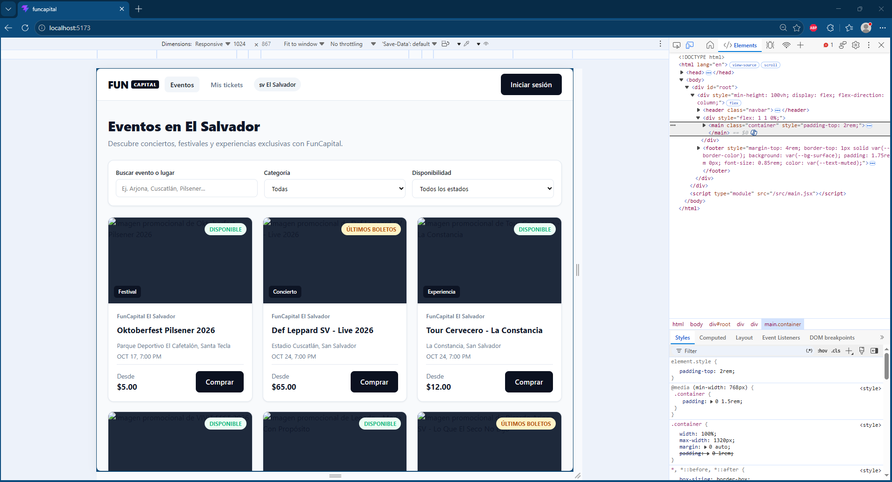
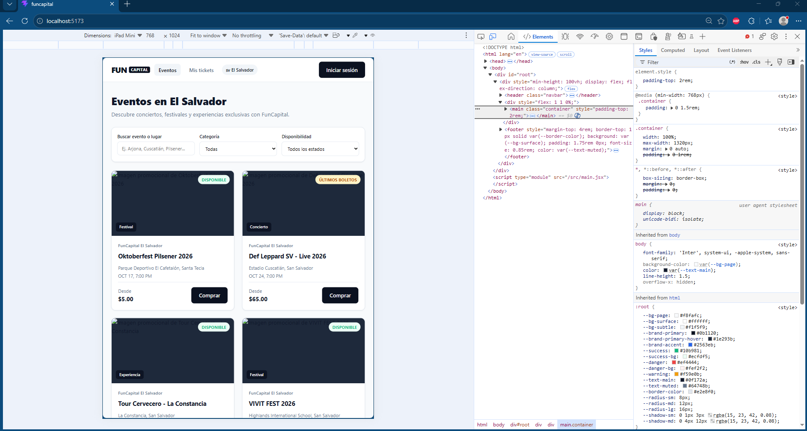

# FunCapital El Salvador — Sitio de compra de boletos

Aplicación web frontend desarrollada con **React 19** y **Vite 8** para la exploración de eventos, selección de localidades, compra simulada en 4 pasos, emisión de pases digitales con código QR y administración de inventario y reportes en El Salvador.

---

## Requisitos e Instalación

1. **Requisitos previos:** Node.js v18+ y npm.
2. **Clonar el repositorio:**
   ```bash
   git clone https://github.com
   cd funcapital
   ```
3. **Instalar dependencias:**
   ```bash
   npm install
   ```
4. **Iniciar servidor de desarrollo:**
   ```bash
   npm run dev
   ```

---

## Arquitectura y Estructura de Carpetas

```text
funcapital/
├── public/                 # Recursos estáticos públicos
├── src/
│   ├── components/         # 14 componentes reutilizables de interfaz
│   │   ├── CheckoutStepper.jsx
│   │   ├── EventCard.jsx
│   │   ├── Footer.jsx
│   │   ├── Modal.jsx
│   │   ├── Navbar.jsx
│   │   ├── OrderSummaryCard.jsx
│   │   ├── PaymentFormFields.jsx
│   │   ├── QuantityStepper.jsx
│   │   ├── SearchFilterBar.jsx
│   │   ├── StatusFeedback.jsx (LoadingSpinner, ErrorBanner, EmptyState)
│   │   └── TicketQRPass.jsx
│   ├── views/              # 6 pantallas principales del flujo
│   │   ├── AdminDashboardView.jsx
│   │   ├── AuthProfileView.jsx
│   │   ├── CheckoutView.jsx
│   │   ├── EventDetailView.jsx
│   │   ├── HomeView.jsx
│   │   └── MyTicketsView.jsx
│   ├── data/
│   │   └── mockData.js     # 8 eventos (3 zonas c/u), usuarios por rol y órdenes iniciales
│   ├── utils/
│   │   └── helpers.js      # Formateo de moneda, códigos QR/orden y helpers de localStorage
│   ├── App.jsx             # Estado global elevado, navegación y persistencia
│   ├── index.css           # Design System, variables CSS y reglas responsivas
│   └── main.jsx            # Punto de entrada React 19
└── README.md
```

---

## Mapa de Estado y Persistencia (`localStorage`)

El estado global se centraliza en `App.jsx` y se sincroniza automáticamente mediante `useEffect` con `localStorage`:

* `fc_events`: Catálogo de 8 eventos e inventario dinámico de cupos por localidad.
* `fc_cart`: Selección activa de evento, zona y cantidad antes de confirmar el pago.
* `fc_orders`: Historial de órdenes confirmadas y boletos digitales con código QR.
* `fc_user`: Sesión activa y rol del usuario (`cliente`, `organizador`, `administrador`).

---

## Datos Simulados y Roles de Prueba

* **Catálogo:** 8 eventos reales/temáticos de El Salvador (Oktoberfest Pilsener, Def Leppard SV, Tour Cervecero La Constancia, VIVIT FEST, Legado Moda, Ricardo Arjona SV, Héroes de Leyenda y EUPHORIA), cada uno con **3 zonas/localidades** y precios diferenciados.
* **Roles disponibles (desde "Iniciar sesión" o "Mi Perfil"):**
  * `cliente`: Búsqueda de eventos, compra en 4 pasos y visualización de boletos QR.
  * `organizador`: Acceso al Panel Admin para gestionar disponibilidad y estados de eventos.
  * `administrador`: Control total de inventario, usuarios y visualización de reportes y analítica.

---

## Evidencia Responsiva (Breakpoints)

### Móvil (`375px`)


### Tablet (`768px`)


### Escritorio (`1440px`)

